### Murat

Vakıfbank'ta full stack developer. Backend'de C# / .NET, frontend'de TypeScript, Android ve TV tarafında Kotlin.

[LinkedIn](https://linkedin.com/in/bunyamintaskin) · [Instagram](https://instagram.com/mrtsknn) · [E-posta](mailto:mrtskn@icloud.com)

 

<picture>
  <source media="(prefers-color-scheme: dark)" srcset="assets/stats-dark.svg" />
  
</picture>
<picture>
  <source media="(prefers-color-scheme: dark)" srcset="assets/langs-dark.svg" />
  
</picture>

Özel repolar dahil, her gün güncellenir.
